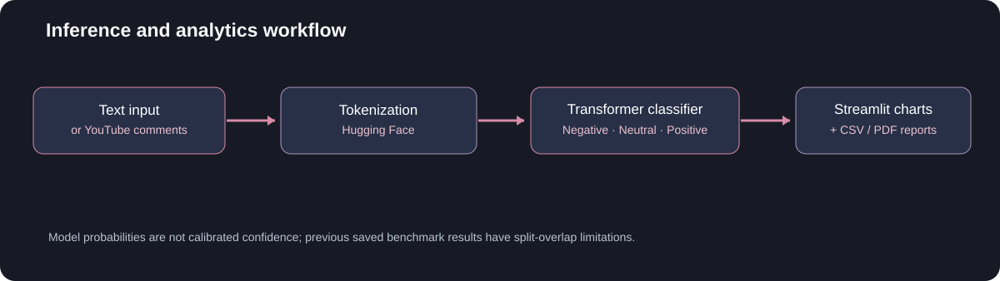
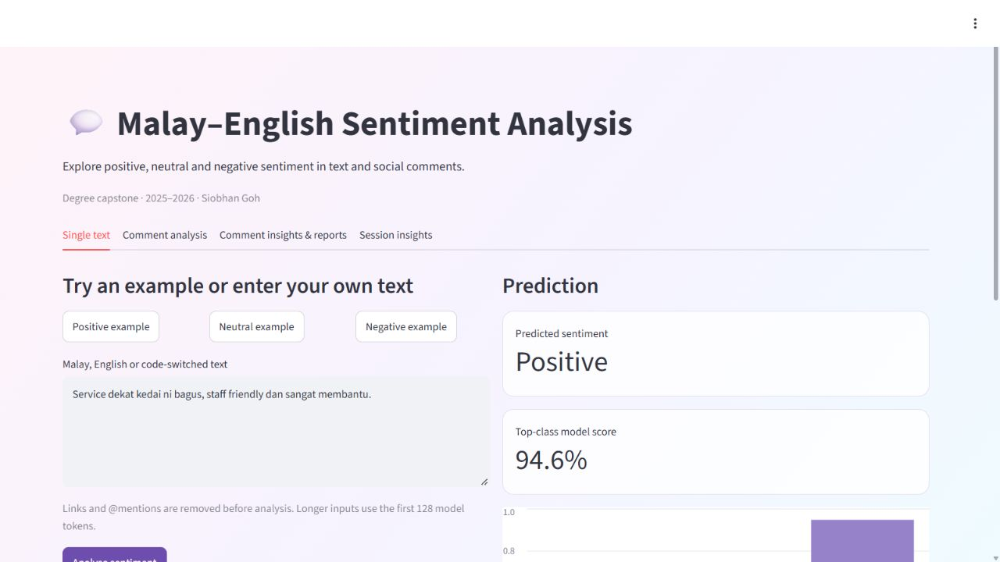

<p align="center"></p>

<p align="center"><strong>Multilingual text classification · Social-comment analytics · Explainability</strong></p>
<p align="center"><a href="https://capstone2-sentiment-streamlit-colab.pages.dev/">Live web app</a> · <a href="https://huggingface.co/spaces/SiobhanGoh/emotion-detection-malaybert-skeleton">Streamlit demo</a> · <a href="#corrected-evaluation">Evaluation</a> · <a href="#reproduce-the-comparison">Reproduce</a> · <a href="#run-the-app">Run the app</a></p>

## Overview

A **2025–26 degree capstone** combining Malay–English sentiment modelling with a Streamlit app for single-text predictions, optional YouTube comment analysis and downloadable reports. Predictions are **Negative / Neutral / Positive**. Existing filenames say “emotion detection”; the implemented task is three-class sentiment polarity.

The evaluation pipeline was repaired in October 2026 to use **one shared, disjoint train/validation/test split** for both TF-IDF logistic regression and multilingual BERT. Historical scores from overlapping splits are superseded. This is a corrected retrospective comparison on the existing corpus, not new external validation.

## Explore the system

| Capability | Implementation |
|---|---|
| Transformer inference | Hugging Face tokenizer and sequence classifier, three logits and softmax |
| Single-text analysis | Sentiment label and class-score distribution |
| Comment analytics | YouTube Data API v3 retrieval or up to 50 pasted comments |
| Reporting | Aggregate sentiment, comment tables, session views and PDF/CSV exports |
| Reproducible modelling | Deterministic preprocessing, duplicate controls, frozen split fingerprints, validation-based selection and common final evaluation |

<p align="center"></p>

## Corrected evaluation

Both models were evaluated once on the same **981 test inputs** after validation selection. No settings were changed using these final results.

| Model | Test accuracy | Test macro-F1 | Selection |
|---|---:|---:|---|
| TF-IDF + logistic regression | 66.46% | 0.6553 | C = 10 |
| Fine-tuned mBERT | 76.04% | 0.7557 | Epoch 4 of 4 |

Full class metrics, confusion matrices, row reconciliation, selection history and model checksum: [corrected comparison](verification/corrected_comparison.json). Tokenizer reload consistency was checked on all 4,577 training inputs: [verification](verification/tokenizer_roundtrip.json).

The original CSV contains **6,999 rows**. The corrected deterministic process excludes **148 rows with conflicting labels for identical normalised text** and **312 remaining duplicates**, retaining **6,539 unique inputs**. There are no empty-text or invalid-label exclusions in this source. The counts reconcile exactly: 6,999 − 148 − 312 = 6,539.

| Partition | Negative | Neutral | Positive | Total |
|---|---:|---:|---:|---:|
| Train | 1,864 | 1,193 | 1,520 | 4,577 |
| Validation | 399 | 256 | 326 | 981 |
| Test | 400 | 255 | 326 | 981 |

- Unicode normalisation, case-folding, URL/mention removal, hashtag-marker removal and whitespace collapse are applied before duplicate grouping. No automatic language filter is used. This is a documented replacement of the old preprocessing, not an explanation of its unreconciled 6,448-row output.
- Identical normalised inputs cannot cross partitions. Conflicting labels are excluded rather than guessed. Near-duplicate detection remains future work.
- The shared stratified **70/15/15** split uses seed 42 and a content fingerprint. The training commands use only train and validation partitions; final evaluation compares both selected models on the same 981 test inputs.
- Baseline: TF-IDF unigrams/bigrams, minimum document frequency 2, up to 30,000 features; logistic regression C is selected from 0.1, 1 and 10 using validation macro-F1. Vocabulary is fitted on training data only.
- mBERT: `google-bert/bert-base-multilingual-cased`, maximum length 128, AdamW at 2e-5, weight decay 0.01, 10% warmup, four epochs, effective batch size 16. The checkpoint with the best validation macro-F1 is selected before the final comparison.
- The run records the base-model revision, split fingerprint and resulting model checksum. GPU training can still vary across hardware/software; a seed does not guarantee bit-for-bit identity.

**Interpretation:** The test partition is disjoint within this corrected run, but earlier development used the broader corpus. These results are internal estimates, not a blind new benchmark or proof of deployment performance. Temporal/source shift, code-switched slang, near duplicates and calibration need separate assessment. Softmax scores are not calibrated probabilities of correctness.

## Reproduce the comparison

Use Python 3.12 in a separate training environment. Supply your own permitted CSV with `Tweet` and `Sentiment` columns; raw social text and model weights are deliberately excluded from this repository.

```bash
git clone https://github.com/SiobhanGoh/capstone2-sentiment-streamlit-colab.git
cd capstone2-sentiment-streamlit-colab
python -m venv .venv
# Windows: .venv\Scripts\activate
# macOS/Linux: source .venv/bin/activate
python -m pip install -r requirements-training.txt
python -m training.run prepare --csv /path/to/cleaned_tweets_sentiments.csv --out runs/data
python -m training.run baseline --data runs/data --out runs/baseline
python -m training.run mbert --data runs/data --out runs/mbert --revision 3f076fdb1ab68d5b2880cb87a0886f315b8146f8
python -m training.run evaluate --data runs/data --baseline runs/baseline --mbert runs/mbert --out runs/comparison.json
```

Prepared partitions and final results reject silent overwrites. Choose a new run directory for a genuinely new experiment, and keep the previous result. Do not tune against the final test result. On Windows, a short `HF_HOME` path can avoid long-cache-path errors. CUDA is optional but substantially faster; install the appropriate official PyTorch build for your hardware.

The [Colab notebook](colab_notebooks/CP2_malaybert_training.ipynb) runs the same pipeline. GitHub Actions runs 32 protocol and app checks without downloading model weights or the private corpus. Install the app requirements plus scikit-learn, joblib, pytest and pypdf, then run `python -m pytest -q tests`.

## App and model status

The corrected checkpoint was deployed on **23 October 2026**. The app pins model revision `9bc6645ce7a8e02761c59386ffd16969bed1bc55`, subfolder `corrected-2026-10`, in `SiobhanGoh/CP2_Emotion_Model_New`. It verifies weights SHA-256 `771a19b8c14865f8d8d8c7adc7df95d859b08a866195f5b7bfe3ac44723ec61b` before loading, checks label order and uses the same normalisation and 128-token limit as the corrected training pipeline. The running app exposes the effective revision and checksum.

Public checks confirmed a single-text prediction, retrieval and analysis of 30 real YouTube comments, and CSV/PDF downloads. This establishes feature operation, not predictive accuracy on YouTube. The app rejects empty cleaned input, excludes unusable comments, clears stale results, handles retrieval failures explicitly and supports pasted comments without an API key. Session history remains per session; reruns do not duplicate predictions.

The summaries show sentiment counts and class scores. Unvalidated emotion-intensity, engagement and business-risk scores have been removed. Class scores are temperature-scaled on validation and described as estimates, not certainties. PDFs paginate and escape comment text; characters unsupported by the PDF font use explicit names/codes, while CSV preserves original text and neutralises spreadsheet-formula prefixes.

Live exploratory checks also found errors: the straightforward negative Malay sentence “Servis lambat dan sangat mengecewakan. 😭” was predicted Positive (model score 0.8927), and “Kedai dibuka pada pukul sembilan.” was predicted Positive (0.8190). These hand-written probes are not an accuracy benchmark, but they demonstrate that the internal test score does not establish reliable everyday-domain behaviour. Do not treat the demonstration as a production-ready general sentiment service.



Screenshot: a functional positive example, not accuracy evidence. [Deployment file verification](verification/deployment_source.json) records the exact deployed Space revision and file checksums. [Feature checks](verification/app_feature_checks.json) separates public browser checks, automated checks and observed prediction limitations.

## Web app (runs in your browser)

[`web/`](https://capstone2-sentiment-streamlit-colab.pages.dev/) is the new front end, live at **capstone2-sentiment-streamlit-colab.pages.dev**: a React site where the model runs **inside the visitor's browser** through ONNX and transformers.js, so typed and uploaded text never leaves their device and there is no server to fall asleep. It covers single-text analysis with all three class scores, comment analysis from pasted text, YouTube or an uploaded CSV (up to 1,000 at a time), search and filter, CSV and PDF exports, and per-browser history. Setup and free Cloudflare Pages deployment are in [web/README.md](web/README.md).

The first browser model (October 2026) was a 16-bit ONNX conversion of the same pinned checkpoint, published at [`SiobhanGoh/malay-english-sentiment-onnx`](https://huggingface.co/SiobhanGoh/malay-english-sentiment-onnx). It was checked on the same frozen 981-input test partition before release ([record](verification/browser_model_evaluation.json)):

| Model file | Size | Test accuracy | Macro-F1 | Same label as full precision |
|---|---:|---:|---:|---:|
| Full-precision ONNX | 712 MB | 76.04% | 0.7557 | 100% |
| **16-bit ONNX (used by the web app)** | 356 MB | 76.04% | 0.7557 | 100% |
| 8-bit ONNX (rejected) | 179 MB | 75.84% | 0.7490 | 89.8% |

The full-precision export reproduces the PyTorch confusion matrix exactly. Running the web app's own code in headless Chrome over the same inputs gave identical labels to the Python evaluation (largest score difference 0.0042). The 8-bit file was not published because it changed about 1 in 10 labels. These checks show the conversion preserved the model; they are not new external validation, and the limitations above still apply.

### Current model: distilled from XLM-RoBERTa-large on Kaggle (80.33%)

Since November 2026 the web app runs a **distilled** model ([Hugging Face revision `7452008`](https://huggingface.co/SiobhanGoh/malay-english-sentiment-onnx/tree/7452008881da33359fd4600be46efbee0381531e)). Training ran on Kaggle's free T4 GPU, launched from GitHub Actions ([workflow](.github/workflows/kaggle.yml), [job](training/kaggle_job.py)); the private corpus stays a private Kaggle dataset and only numbers come back.

1. **Teacher.** XLM-RoBERTa-large fine-tuned on the 4,577 training comments, three seeds. A first schedule was too short (validation macro-F1 still rising when it ended, best 0.697) and is kept in the record; the longer one reached 0.759–0.773 against mBERT's 0.742.
2. **What did not help.** A first stage on 150,276 ChatGPT-labelled Malaysian tweets ([mesolitica/chatgpt-explain-sentiment](https://huggingface.co/datasets/mesolitica/chatgpt-explain-sentiment)) left models at mBERT's level: those labels agree poorly with this corpus. None of the tweets matched a validation or test comment, exactly or nearly.
3. **Distillation.** Three large models are about 3.3 GB, too big for a browser, so the published mBERT checkpoint was retrained to copy the teacher's soft labels over the training comments and the tweets (used as unlabelled text). The student is the same size as before.

Every choice (schedule, teacher, student, blend) was made on validation; each test score was computed once afterwards ([selection](verification/kaggle_selection.json), [student](verification/distill_selection.json), [ONNX check](verification/student_onnx_evaluation.json), [browser check](verification/browser_student_evaluation.json)).

| Test, 981 inputs | Accuracy | Macro-F1 |
|---|---:|---:|
| Original fine-tuned mBERT | 76.04% | 0.7557 |
| Previous web app (mBERT + TF-IDF) | 77.37% | 0.7668 |
| Teacher: 3 × XLM-RoBERTa-large + TF-IDF (not deployable) | 79.00% | 0.7846 |
| Distilled student alone, 16-bit | 79.61% | 0.7943 |
| **Web app now: student + TF-IDF** | **80.33%** | **0.8001** |

Against the previous web app the new one gets 78 test inputs right that it got wrong, and 49 the other way round (McNemar exact p = 0.013; 95% bootstrap interval for the accuracy gain +0.7 to +5.2 points). Against the original mBERT: 93 and 51 (p < 0.001). The published 16-bit file gives the same label as the trained PyTorch student on every validation and test input, and the web app's own code in headless Chrome reproduces the Python result on all 981 test inputs. Average calibration error on test is about 6.6 points. Caveat: validation guided many choices across this project and the test split has been scored for several experiments, so the true gain is probably somewhat smaller than measured; this remains retrospective internal evidence. Because training used mesolitica data offered for research, non-commercial use, the published model carries the same restriction.

### Tried after that, and not adopted

Both were judged on validation only; neither beat the current approach, so the test split was not used again ([record](verification/further_experiments.json)).

- **A 7B chat model as the classifier.** [Malaysian-Qwen2.5-7B-Instruct](https://huggingface.co/mesolitica/Malaysian-Qwen2.5-7B-Instruct) fine-tuned with QLoRA on the free T4 reached a validation macro-F1 of about 0.68 (XLM-RoBERTa-large: 0.76–0.77). It memorised the training comments rather than generalising, and adding it to the XLM-R ensemble lowered validation scores.
- **Cleaner training labels.** Cross-validated predictions flagged 782 training comments (17%) as possibly mislabelled. A blind relabel of those plus 50 controls (by Claude, an AI, shown only the text) agreed with the original labels on just 56% of the controls, leaning towards Neutral: a different labelling convention rather than clear errors. Retraining with 329 labels changed where the relabel and the held-out model agreed, or with the flagged rows removed, lowered validation macro-F1 (0.753 and 0.761 against 0.781), so the original labels stay.

### Earlier step: small gain without retraining (77.37%)

Training larger models on a free Colab T4 did not help: three Malay and multilingual candidates, selected on validation only, all scored at or below mBERT on test (best 75.84%). Instead the app now adjusts mBERT's output with options that run on a CPU in seconds ([script](training/post_hoc.py), [record](verification/post_hoc_evaluation.json)). Four options were fixed in advance and compared by 5-fold cross-validation inside the validation split; the test split was scored once, afterwards.

| Option | Validation CV macro-F1 | Test accuracy | Test macro-F1 | vs mBERT (McNemar p) |
|---|---:|---:|---:|---:|
| mBERT as published | 0.7422 | 76.04% | 0.7557 | — |
| mBERT + class offsets | 0.7442 | 77.17% | 0.7639 | 0.144 |
| **3:1 blend of mBERT and the TF-IDF baseline (selected)** | 0.7480 | **77.37%** | **0.7668** | **0.047** |
| Blend + class offsets | 0.7364 | 77.17% | 0.7639 | 0.144 |

The selected blend gets 25 test inputs right that mBERT gets wrong, and 12 the other way round: +1.33 accuracy points (95% bootstrap interval +0.10 to +2.55). That is a small gain at the edge of statistical significance, not a large one; the macro-F1 interval (−0.11 to +2.35 points) includes zero. A temperature fitted on validation also makes the scores track how often labels are right: average calibration error on test fell from 9.1 to 5.9 points for the blend (3.1 for mBERT alone). The TF-IDF weights are served as a public file (`web/public/tfidf.json`, words and bigrams with their weights; no comment text). The web app's own code reproduces the Python blend [on all 981 test inputs](verification/browser_blend_evaluation.json). Same caveat: retrospective internal evidence on the existing corpus.

## Run the Streamlit app

The app uses Python 3.12 with pinned dependencies. The Docker Space installs the CPU build of PyTorch. From the repository root:

```bash
cd hf_space_streamlit
python -m venv .venv
# Activate this environment, then:
python -m pip install -r requirements.txt
python -m streamlit run src/streamlit_app.py
```

`src/model_release.json` fixes the model revision, subfolder, checksum and evaluation provenance. `SENTIMENT_MODEL_PATH` can point to a local copy of the same checkpoint for local testing; the checksum is still enforced. `YOUTUBE_API_KEY` enables comment retrieval and must be stored privately as an environment variable or Hugging Face Space secret. Never commit it. Paste comments works without a key.

## Explainability and original work

The original exploration contains LIME wrappers for the baseline and mBERT. SHAP LinearExplainer covers the **TF-IDF logistic-regression baseline only**. These explanation experiments have not been rerun for the corrected checkpoint; no transformer SHAP or explanation-fidelity claim is made.

The corrected notebook replaces the old independent splits. Original CP2 code is kept in [an explicitly disabled historical notebook](colab_notebooks/archive/CP2_original_exploration.ipynb), with all saved outputs removed. Original outputs remain in Git history and should not be used as valid accuracy evidence. CP1 is historical exploratory work; [the notebook guide](colab_notebooks/README.md) explains the distinction.

## Repository map

```text
training/                 # Shared preprocessing, selection and final evaluation
requirements-training.txt # Tested training dependencies
tests/                    # Protocol, inference helpers, exports and app checks
verification/             # Aggregate results; no raw social text
colab_notebooks/           # Corrected workflow and historical source
hf_space_streamlit/       # Verified deployed app source and pinned environment
web/                      # In-browser React app, YouTube function and its tests
assets/                   # Architecture and real app screenshot
```

## Remaining work

- Assess near-duplicates, source/time-based generalisation and probability calibration.
- Evaluate a new external sample before making broader deployment-performance claims.
- Rerun explainability experiments for the corrected checkpoint if needed; historical explanations do not describe this release.

Scope: sentiment analysis and social-comment analytics; no clinical inference, validated fine-grained emotion detection or live Twitter streaming.

---

**Siobhan Goh** · Master of Artificial Intelligence, Monash University Malaysia · [LinkedIn](https://www.linkedin.com/in/siobhan-goh/)
