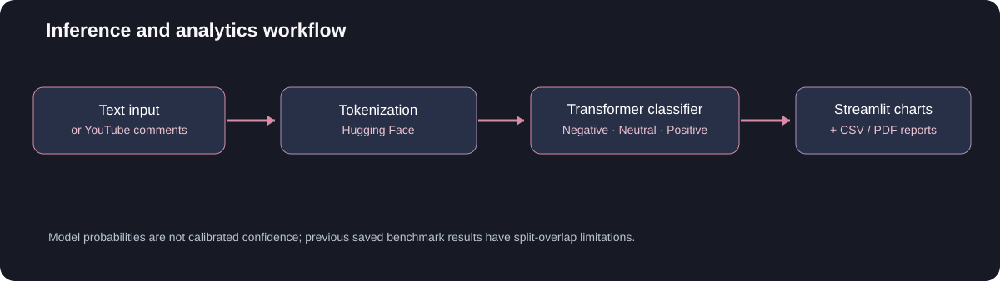
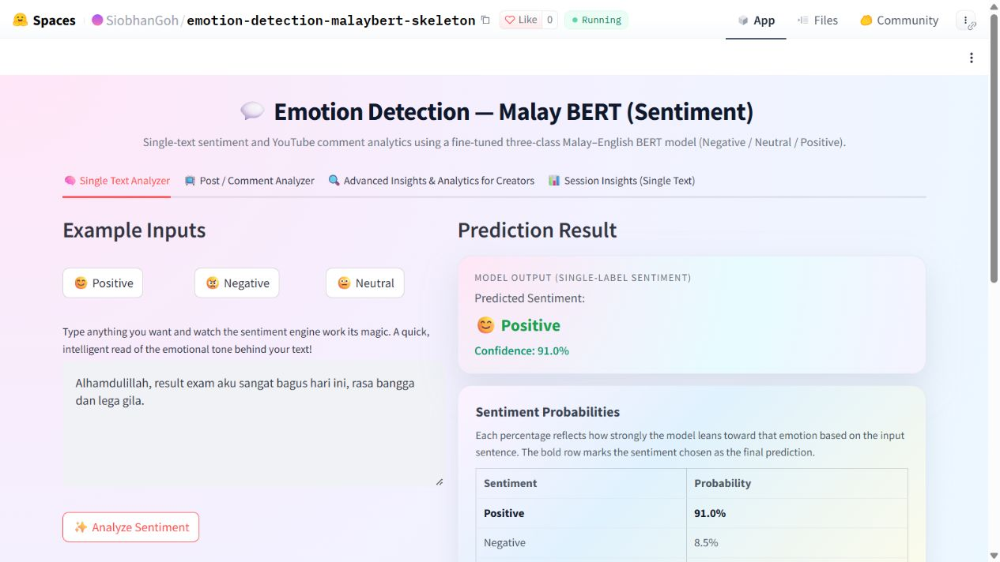

<p align="center"></p>

<p align="center"><strong>Multilingual text classification · Social-comment analytics · Explainability</strong></p>
<p align="center"><a href="https://huggingface.co/spaces/SiobhanGoh/emotion-detection-malaybert-skeleton">Hugging Face demo</a> · <a href="#corrected-evaluation">Evaluation</a> · <a href="#reproduce-the-comparison">Reproduce</a> · <a href="#run-the-app">Run the app</a></p>

## Overview

A **2025–26 degree capstone** combining Malay–English sentiment modelling with a Streamlit app for single-text predictions, optional YouTube comment analysis and downloadable reports. Predictions are **Negative / Neutral / Positive**. Existing filenames say “emotion detection”; the implemented task is three-class sentiment polarity.

The evaluation pipeline was repaired in October 2026 to use **one shared, disjoint train/validation/test split** for both TF-IDF logistic regression and multilingual BERT. Historical scores from overlapping splits are superseded. This is a corrected retrospective comparison on the existing corpus, not new external validation.

## Explore the system

| Capability | Implementation |
|---|---|
| Transformer inference | Hugging Face tokenizer and sequence classifier, three logits and softmax |
| Single-text analysis | Sentiment label and class-score distribution |
| Comment analytics | YouTube Data API v3 ingestion when an authorised API key is configured |
| Reporting | Aggregate sentiment, comment tables, session views and PDF/CSV exports |
| Reproducible modelling | Deterministic preprocessing, duplicate controls, frozen split fingerprints, validation-based selection and common final evaluation |

<p align="center"></p>

## Corrected evaluation

Both models were evaluated once on the same **981 test inputs** after validation selection. No settings were changed using these final results.

| Model | Test accuracy | Test macro-F1 | Selection |
|---|---:|---:|---|
| TF-IDF + logistic regression | 66.46% | 0.6553 | C = 10 |
| Fine-tuned mBERT | 76.04% | 0.7557 | Epoch 4 of 4 |

Full class metrics, confusion matrices, row reconciliation, selection history and model checksum: [corrected comparison](verification/corrected_comparison.json). Tokenizer reload consistency was checked on all 4,577 training inputs: [verification](verification/tokenizer_roundtrip.json).

The original CSV contains **6,999 rows**. The corrected deterministic process excludes **148 rows with conflicting labels for identical normalised text** and **312 remaining duplicates**, retaining **6,539 unique inputs**. There are no empty-text or invalid-label exclusions in this source. The counts reconcile exactly: 6,999 − 148 − 312 = 6,539.

| Partition | Negative | Neutral | Positive | Total |
|---|---:|---:|---:|---:|
| Train | 1,864 | 1,193 | 1,520 | 4,577 |
| Validation | 399 | 256 | 326 | 981 |
| Test | 400 | 255 | 326 | 981 |

- Unicode normalisation, case-folding, URL/mention removal, hashtag-marker removal and whitespace collapse are applied before duplicate grouping. No automatic language filter is used. This is a documented replacement of the old preprocessing, not an explanation of its unreconciled 6,448-row output.
- Identical normalised inputs cannot cross partitions. Conflicting labels are excluded rather than guessed. Near-duplicate detection remains future work.
- The shared stratified **70/15/15** split uses seed 42 and a content fingerprint. The training commands use only train and validation partitions; final evaluation compares both selected models on the same 981 test inputs.
- Baseline: TF-IDF unigrams/bigrams, minimum document frequency 2, up to 30,000 features; logistic regression C is selected from 0.1, 1 and 10 using validation macro-F1. Vocabulary is fitted on training data only.
- mBERT: `google-bert/bert-base-multilingual-cased`, maximum length 128, AdamW at 2e-5, weight decay 0.01, 10% warmup, four epochs, effective batch size 16. The checkpoint with the best validation macro-F1 is selected before the final comparison.
- The run records the base-model revision, split fingerprint and resulting model checksum. GPU training can still vary across hardware/software; a seed does not guarantee bit-for-bit identity.

**Interpretation:** The test partition is disjoint within this corrected run, but earlier development used the broader corpus. These results are internal estimates, not a blind new benchmark or proof of deployment performance. Temporal/source shift, code-switched slang, near duplicates and calibration need separate assessment. Softmax scores are not calibrated probabilities of correctness.

## Reproduce the comparison

Use Python 3.12 in a separate training environment. Supply your own permitted CSV with `Tweet` and `Sentiment` columns; raw social text and model weights are deliberately excluded from this repository.

```bash
git clone https://github.com/SiobhanGoh/capstone2-sentiment-streamlit-colab.git
cd capstone2-sentiment-streamlit-colab
python -m venv .venv
# Windows: .venv\Scripts\activate
# macOS/Linux: source .venv/bin/activate
python -m pip install -r requirements-training.txt
python -m training.run prepare --csv /path/to/cleaned_tweets_sentiments.csv --out runs/data
python -m training.run baseline --data runs/data --out runs/baseline
python -m training.run mbert --data runs/data --out runs/mbert --revision 3f076fdb1ab68d5b2880cb87a0886f315b8146f8
python -m training.run evaluate --data runs/data --baseline runs/baseline --mbert runs/mbert --out runs/comparison.json
```

Prepared partitions and final results reject silent overwrites. Choose a new run directory for a genuinely new experiment, and keep the previous result. Do not tune against the final test result. On Windows, a short `HF_HOME` path can avoid long-cache-path errors. CUDA is optional but substantially faster; install the appropriate official PyTorch build for your hardware.

The [Colab notebook](colab_notebooks/CP2_malaybert_training.ipynb) runs the same pipeline. Run `python -m pip install pytest` then `python -m pytest -q tests` for the five preprocessing, partition and baseline-selection checks. GitHub Actions runs these checks without downloading model weights or the private corpus.

## App and model status

The public Space was woken and returned **Positive** for its built-in positive example on **22 October 2026**. This confirms that the single-text demo works; it is not an accuracy test. YouTube retrieval and its report exports were not exercised in this live check.

The public Space source at revision `af938930b0426fe4c12afafa98a847a8f5733285` defaults to `SiobhanGoh/CP2_Emotion_Model_New`. Its public model repository resolved to revision `cc32f08fdce15925a79c799d02a75888fc194e23` on 22 October 2026. The app does not expose its effective loaded revision, so these metadata observations do not prove a checksum match to the running weights.

**The newly evaluated checkpoint has not replaced the public demo model.** Do not attribute the corrected comparison's scores to that older demo. A model promotion should include matching text preprocessing, label mapping, pinned revision and app regression checks.



Screenshot: 22 October 2026. The displayed confidence is an uncalibrated model score, not a measured success rate.

## Run the app

The existing app environment is separate from the Python 3.12 training environment. Its Dockerfile uses Python 3.10 and its original dependency file. From the repository root:

```bash
cd hf_space_streamlit
python -m venv .venv
# Activate this environment, then:
python -m pip install -r requirements.txt
python -m streamlit run src/streamlit_app.py
```

`MODEL_ID` optionally selects a compatible Hugging Face model. `YOUTUBE_API_KEY` enables comment retrieval and must be stored privately as an environment variable or Hugging Face Space secret. The existing app dependencies are older; the corrected training environment does not certify their installation on other Python versions. The public demo check is recorded separately above.

## Explainability and original work

The original exploration contains LIME wrappers for the baseline and mBERT. SHAP LinearExplainer covers the **TF-IDF logistic-regression baseline only**. These explanation experiments have not been rerun for the corrected checkpoint; no transformer SHAP or explanation-fidelity claim is made.

The corrected notebook replaces the old independent splits. Original CP2 code is kept in [an explicitly disabled historical notebook](colab_notebooks/archive/CP2_original_exploration.ipynb), with all saved outputs removed. Original outputs remain in Git history and should not be used as valid accuracy evidence. CP1 is historical exploratory work; [the notebook guide](colab_notebooks/README.md) explains the distinction.

## Repository map

```text
training/                 # Shared preprocessing, selection and final evaluation
requirements-training.txt # Tested training dependencies
tests/                    # Protocol and baseline checks
verification/             # Aggregate results; no raw social text
colab_notebooks/           # Corrected workflow and historical source
hf_space_streamlit/       # Existing demo app source and environment
assets/                   # Architecture and real app screenshot
```

## Remaining work

- Assess near-duplicates, source/time-based generalisation and probability calibration.
- Promote a verified checkpoint through matching app preprocessing and pinned model revision.
- Exercise YouTube retrieval and all report exports with an authorised API key.

Scope: sentiment analysis and social-comment analytics; no clinical inference, validated fine-grained emotion detection or live Twitter streaming.

---

**Siobhan Goh** · Master of Artificial Intelligence, Monash University Malaysia · [LinkedIn](https://www.linkedin.com/in/siobhan-goh/)
